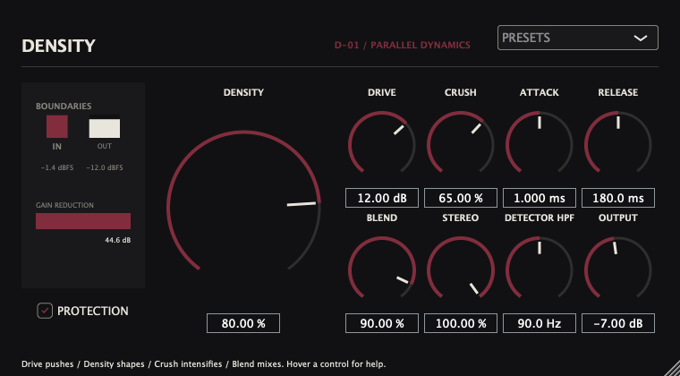
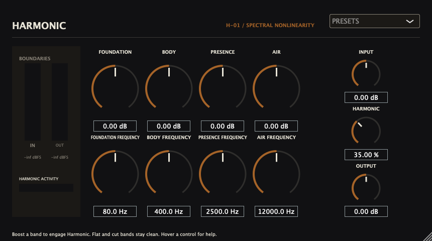
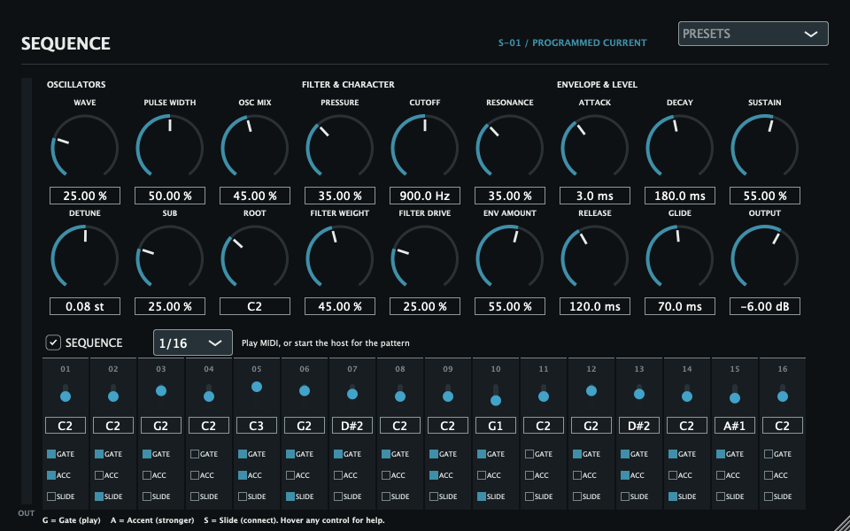
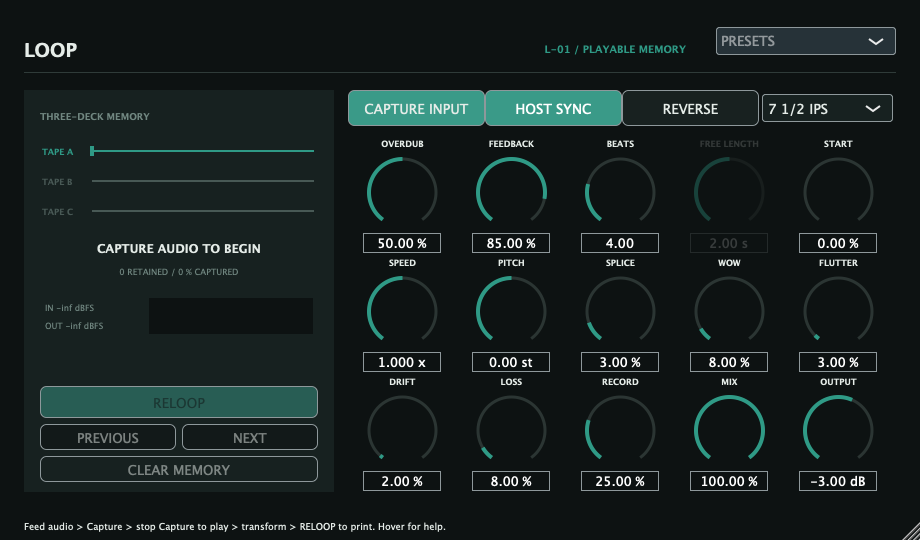
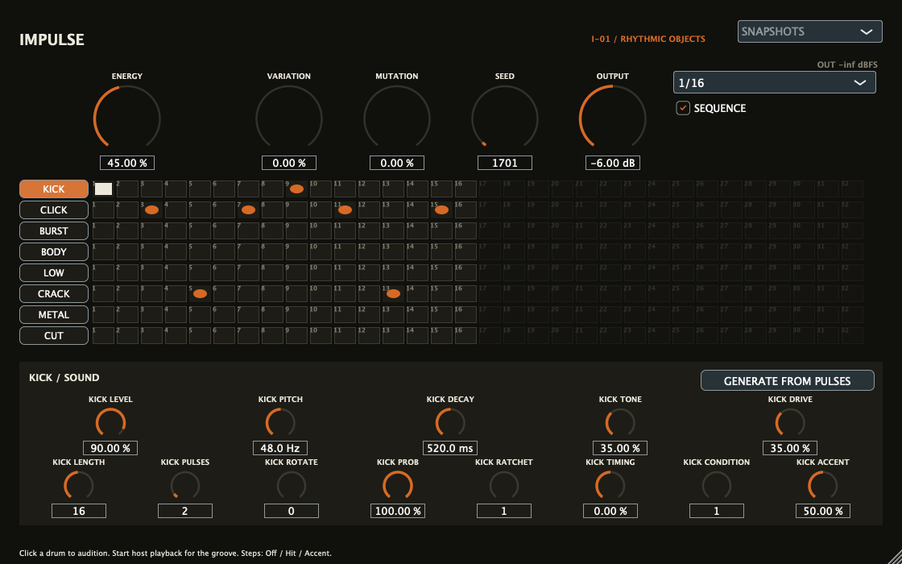
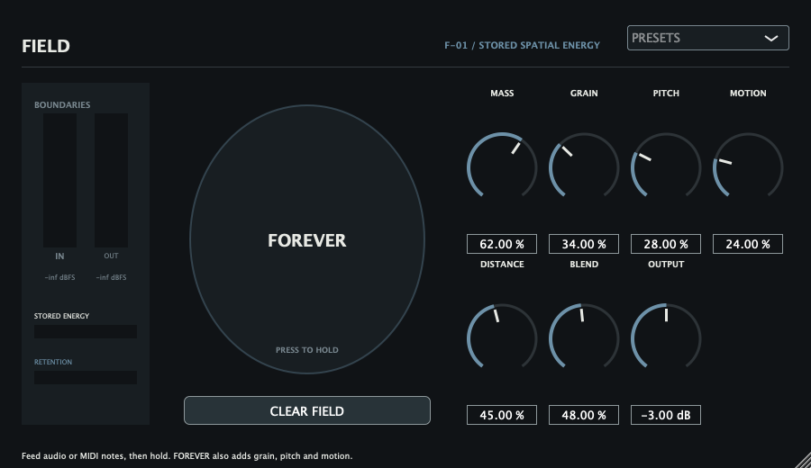

# Interface review of the six production editors

This review inspected **actual JUCE editor images and implementation**, not new
wireframes. It is a visual/source review, not a live Cubase, Retina, keyboard,
VoiceOver or first-time-user study. Musical interpretations are hypotheses.
Baseline source: `8a603dcbc59b52a58637fe6305676efc5a406f80`.

Five PNGs were copied from the baseline builds retained in
`build-r01/worktree/build-plugin/*_editor_artifacts/`. Harmonic's missing image
was generated by that build's `harmonic_plugin_tests --editor-artifacts` into
this folder; the command passed. These are software component renders, not
screenshots of a plugin running in Cubase. The Density image deliberately shows
the artifact fixture's Drive=12 dB, Density=80% and active test meters; it is
**not a default-settings screenshot**. The other images show their test
editor states, mostly fresh/idle.

## Actual editor evidence

| Product | Minimum-size image | What the image establishes |
|---|---|---|
| Density | [760×420](screenshots/density-minimum.png) | Clear Density hero, separated output, all ten controls and Protection present; no visibility into actual threshold/ratio/saturation contribution |
| Harmonic | [860×480](screenshots/harmonic-minimum.png) | Four band pairs and input/macro/output grouping; all gains flat while Harmonic reads 35%; shelf versus bell identity only explained by hover text |
| Sequence | [960×600](screenshots/sequence-minimum.png) | Oscillator/filter/envelope groups and all 16 steps visible; large uniform knob grid and compact per-step toggles |
| Loop | [920×540](screenshots/loop-minimum.png) | Clear capture instruction, disabled inapplicable Free Length, three-deck panel; Record/Loss still presented alongside unrelated playback controls |
| Impulse | [1120×700](screenshots/impulse-minimum.png) | Eight 32-step rows plus one selected sound; inactive second half dimmed; the smallest grid cells and controls are dense |
| Field | [900×520](screenshots/field-minimum.png) | Strong FOREVER hierarchy and Clear Field; stored-energy/retention displays lack units and behavioral context |

## What works, and where apparent simplicity conceals behavior

**The family identity is already coherent.** Near-black panels, technical text,
restrained product accents, editable numerical boxes and bounded state-driven
motion are consistent. Replacing them with hardware decoration or scientific
animation would not address the reported problem. The stronger direction is
to make the existing gestures explain their causes and consequences.
[Design system](../../UI_SYSTEM.md).

**Density:** the large hero communicates priority and the meter separates gain
reduction from output level. But “Drive pushes / Density shapes / Crush
intensifies / Blend mixes” is only a first layer: the three nonlinear/dynamic
controls coordinate internal quantities that are not shown. A user can see
44.6 dB reduction in the artifact yet cannot infer how much of that compressed
branch contributes to the final result. A compact active-branch/contribution
cue or context explanation is preferable to more knobs. This is a usability
hypothesis; the screenshot does not demonstrate a failed musician task.
[Editor](../../../apps/density/density_plugin.cpp), lines 199–260 and 270–382;
[artifact fixture](../../../tests/density_plugin_tests.cpp), lines 807–853.

**Harmonic:** the flat initial gains make the global 35% macro ineffective by
design, even though it looks ready to color sound. The bottom instruction
correctly says to boost a band; it is small compared with eleven active-looking
controls. Show a local “boost a band to engage” indication or dim the activity
claim while no bands participate, without disabling unrelated input/output.
Foundation and Air are shelves in current production; a small shelf/bell
shape cue beside each band is more direct than relying entirely on tooltips.
Do not display a fabricated spectrum or imply measured harmonic quantities
from the existing activity proxy. [Editor](../../../apps/harmonic/harmonic_plugin.cpp),
lines 244–354; [shared explanations](../../../libs/parameters/plugin_ui.hpp),
lines 32–45.

**Sequence:** grouping and note names are meaningful improvements, and the mode
line distinguishes host sequencing from MIDI keyboard playback. The full
16-step view aids phrasing. However, Pressure remains one similarly sized knob
among 18 rather than an obviously playable macro; the panel does not directly
explain what Filter Weight does until hover. A visible two-pole↔four-pole cue
and an envelope-response demonstration grounded in actual state could improve
intent, but the latter is not justified until its value is tested. Existing
gate/accent/slide controls have fixed 24-pixel row heights at minimum size;
keyboard operation and target precision need observed task testing.
[Editor](../../../apps/sequence/sequence_plugin.cpp), lines 235–297, 439–492;
[explanations](../../../libs/parameters/plugin_ui.hpp), lines 46–67.

**Loop:** Capture Input, Stop Capture, the empty-memory cue and disabled
inapplicable duration control now communicate the first action correctly.
This audit must not repeat the superseded claim that tapes are lost on reopen:
schema 3 saves them. The primary opportunity is grouping by live capture,
playback transformation and irreversible generational print. Feedback does
nothing to a tape merely playing with Capture off; Record and Loss affect both
playback and print differently. The UI should state those relationships.
“Host Sync” presently means tempo-derived duration, not quantized capture or
host-PPQ phase lock. Rename its visible explanation before promising more
transport features. [Editor](../../../apps/loop/loop_plugin.cpp), lines 298–430;
[processing](../../../apps/loop/loop_processor.cpp), lines 352–398;
[state](../../products/loop/STATE_FORMAT.md).

**Impulse:** all rows are visible and selecting a track reveals sound and rhythm
controls without modal navigation. But at minimum size the 32-column cells are
about 28 pixels wide and 22 high; most labels/numbers are much smaller than the
global controls. A selected-row precision focus, keyboard step movement and
clearer hit/accent symbols deserve testing before adding more sequence data.
Selecting a track also auditions it, so merely inspecting another object's
controls can inject an extra hit into a running performance. Separate select
from explicit audition, or at least offer a clear modifier/gesture, without
redesigning it as N-01. Generate-from-pulses correctly requires an explicit
action, but this dependency is mainly explained on hover. Per-track controls
do not all have uniquely specified explicit keyboard order in the editor;
accessible titles are not proof of practical traversal through 256 cells.
[Editor](../../../apps/impulse/impulse_plugin.cpp), lines 330–365 and 410–463;
[explanations](../../../libs/parameters/plugin_ui.hpp), lines 101–120.

**Field:** FOREVER has unmistakable hierarchy, Clear Field is separate, and
empty/occupied text feedback is useful. The strongest issue is semantic:
Stored Energy measures a filtered mono sum rather than all stored line energy;
opposing line values can cancel. Retention displays the pre-pitch-trim
coefficient rather than measured decay. Correct the label/measurement first,
then show that hold also alters Grain/Pitch/Motion and changes Mass's role.
The footer already mentions extra motion, but an armed performance should not
require discovering hidden minimum amounts by ear.
[Meter/hold UI](../../../apps/field/field_plugin.cpp), lines 187–229 and 349–359;
[DSP](../../../apps/field/field_processor.cpp), lines 202–217 and 308–312.

## Workflow and accessibility gaps across the family

- **Preset identity is editor-local.** `PresetMenu` stores the chosen name and
  parameter snapshot inside the ComboBox after a menu selection. Closing and
  recreating the editor loses that name; no restore/matching is performed.
  Existing parameter recall is not broken, but session navigation can fall back
  to PRESETS/SNAPSHOTS rather than explaining a recognizable starting point.
  Exact preset matching on open, or explicit “Custom”, can be investigated
  without altering sound state. [Implementation](../../../libs/parameters/plugin_ui.hpp),
  lines 157–184.
- **Automation changes values, but ownership is mostly implicit.** JUCE
  attachments expose host values; no native host write/read/touch/latch trial
  was performed. Loop print/history actions and Field Clear are not ordinary
  parameter automation. Explain the distinction and MIDI alternatives rather
  than silently making discrete actions persistent booleans.
  [Loop adapter](../../../apps/loop/loop_plugin.cpp), lines 592–639;
  [Field adapter](../../../apps/field/field_plugin.cpp), lines 454–475.
- **Exact entry and tooltips are present, not fully validated usability.**
  Labels, focus metadata and fixed-size regression tests provide evidence of
  implementation. They do not prove screen-reader usefulness, focus routing
  within Cubase or accurate manipulation under performance pressure. Density
  has a tested complete eleven-control order; other custom grids need real
  traversal testing. [Density keyboard test](../../../tests/density_plugin_tests.cpp),
  lines 763–771; [existing UX limits](../../UX_REVIEW.md).
- **All signal-dependent graphics need semantic review.** A nonzero DSP
  variable is not automatically the right measurement to communicate. Field's
  energy bar is the clearest example; a future graph must represent something
  a musician can act on, with its units/scale explicit.

## Prioritized usability work

| Priority | Smallest improvement | Expected benefit / confidence | Compatibility risk |
|---|---|---|---|
| 1 | Honest Field energy/retention labels or corrected bounded meters | Strong causal clarity; high source confidence, musical benefit untested | Meter/UI-only can preserve sound; thresholds/status behavior must be retested |
| 1 | Expose inactive/changed roles: Harmonic without boosts, Loop Feedback outside Capture, Field Mass during hold | Fewer apparently ineffective moves; high mechanism confidence | UI/text-only, no parameter reinterpretation |
| 1 | Separate Impulse selection from audition | Avoid accidental notes while inspecting a sound; code-confirmed coupling | Interaction change; preserve a clearly accessible audition gesture |
| 2 | Explain Loop Overdub endpoints and tempo-duration sync | Predictable capture/gain and transport expectations | No DSP/state change needed |
| 2 | Remember/infer preset identity on editor reopen, with honest Custom state | Better session navigation and comparison | Prefer metadata/inference over audio-state schema change |
| 2 | Precision and keyboard pass on Impulse cells/Sequence step toggles | Improve performance editing and accessibility | No new musical parameters; must preserve full-pattern overview |
| 3 | More explicit macro/signal-stage relationships and shelf/bell cues | Reveal existing expressive behavior | Validate information density at minimum size; avoid decorative plots |

Acceptance requires observed tasks: deliberately reach two contrasting sounds,
predict which control changes them, automate/repeat the gesture, reopen the
session, and locate the same state without explanation. Record failures and
edits/time separately from preference. None of those human task results is
claimed here, and no production interface was changed by this audit.
